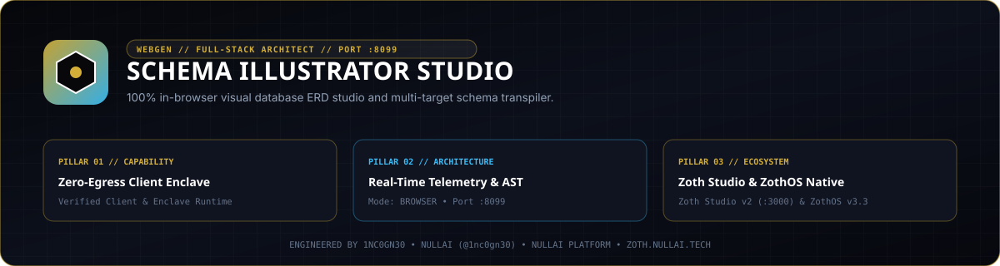

<p align="center">
  
</p>

# Schema Illustrator Studio

**Zero-dependency Python 3.9+ multi-format schema parser, interactive SVG/Mermaid entity-relationship diagram (ERD) renderer, cross-language type transpiler, differential migration analyzer, referential mock data synthesizer, and MCP server.**

- **Zoth Studio v2 Dossier**: [https://zoth.nullai.tech/tools/schema-illustrator-studio](https://zoth.nullai.tech/tools/schema-illustrator-studio)
- **Default Loopback Endpoint**: `http://127.0.0.1:8099`
- **Runtime Dependencies**: Zero external Python runtime packages (100% Python `stdlib`)
- **License**: MIT (100% free and open-source)

---

## Overview

`schema-illustrator-studio` parses heterogeneous database and API schema definitions into a canonical entity-relationship AST, renders interactive SVG and Mermaid `erDiagram` graphs, evaluates relational complexity and normalization metrics, computes differential schema migrations (`ALTER TABLE` / breaking-change drift), generates referentially consistent mock seed data, and transpiles models across SQL DDL, JSON Schema, TypeScript, Python Pydantic v2, and GraphQL SDL.

---

## Architecture

```text
src/schema_illustrator_studio/
├── parser.py              # Auto-detecting parser for SQL DDL, JSON Schema, OpenAPI, TypeScript & GraphQL SDL
├── transpiler.py          # Cross-format emitter (TypeScript, Pydantic v2, SQL DDL, GraphQL, JSON Schema, Mermaid)
├── erd_renderer.py        # Deterministic topological layout engine for SVG ERD & ASCII table diagrams
├── metrics.py             # Relational graph telemetry, foreign-key fan-in/out & normalization scoring
├── diff_engine.py         # Differential schema drift analyzer & SQL migration DDL generator
├── mock_generator.py      # Referential synthetic data generator (JSON, SQL INSERT, CSV)
├── mcp_server.py          # JSON-RPC 2.0 stdio MCP server exposing 8 schema engineering tools
├── ui_server.py           # Loopback HTTP API + browser workstation server (127.0.0.1:8099)
└── cli.py                 # Unified CLI entrypoint (`schema-illustrator` / `schema-illustrator-studio`)
```

---

## Quickstart

```bash
git clone https://github.com/1nc0gn30/schema-illustrator-studio.git
cd schema-illustrator-studio
python3 -m pip install -e ".[dev]"

# Start the loopback web workstation on http://127.0.0.1:8099
schema-illustrator-studio serve --host 127.0.0.1 --port 8099 --no-open
```

Run directly from a source checkout without installing:

```bash
PYTHONPATH=src python3 -m schema_illustrator_studio.cli serve --port 8099 --no-open
```

---

## CLI & MCP Usage

### CLI Subcommands

Installed entrypoints: `schema-illustrator` and `schema-illustrator-studio`.

```bash
# View CLI flags
schema-illustrator-studio --help

# Export a built-in sample schema (ecommerce, auth, social, saas)
schema-illustrator-studio samples -n ecommerce -o ecommerce.sql

# Parse a schema into canonical AST JSON
schema-illustrator-studio parse ecommerce.sql

# Transpile SQL DDL into Python Pydantic v2 models or TypeScript interfaces
schema-illustrator-studio transpile ecommerce.sql -t pydantic
schema-illustrator-studio transpile ecommerce.sql -t typescript

# Render an SVG ERD diagram or Mermaid erDiagram syntax
schema-illustrator-studio erd ecommerce.sql -o erd.svg
schema-illustrator-studio mermaid ecommerce.sql

# Compute schema complexity, foreign-key density, and architecture metrics
schema-illustrator-studio metrics ecommerce.sql

# Diff two schema versions and inspect migration DDL
schema-illustrator-studio diff v1.sql v2.sql

# Generate referentially consistent mock seed data (json, sql, csv)
schema-illustrator-studio mock ecommerce.sql --rows 10 --format sql

# Run system diagnostics or internal self-test
schema-illustrator-studio doctor
schema-illustrator-studio test

# Launch the stdio MCP server
schema-illustrator-studio mcp
```

### ZothOS v3.4.0 CLI Integration

On ZothOS v3.4.0 workstations, `schema-illustrator` is installed in `/usr/local/bin/schema-illustrator`:

```bash
schema-illustrator samples --list
schema-illustrator web       # Starts http://127.0.0.1:8099
schema-illustrator desktop   # Launches the Electron workstation shell
```

### Model Context Protocol (MCP) Tools

```json
{
  "mcpServers": {
    "schema-illustrator-studio": {
      "command": "schema-illustrator-studio",
      "args": ["mcp"]
    }
  }
}
```

| MCP Tool | Description |
| :--- | :--- |
| `schema_parse` | Parse SQL DDL, JSON Schema, OpenAPI, TypeScript, or GraphQL into a normalized entity AST |
| `schema_transpile` | Transpile any supported schema into TypeScript, Pydantic v2, SQL, GraphQL, JSON Schema, or Mermaid |
| `schema_export_erd` | Render an SVG entity-relationship diagram or terminal ASCII layout |
| `schema_metrics` | Compute entity/field/relation counts, graph depth, and complexity score |
| `schema_diff` | Compare base and target schemas, highlight breaking changes, and emit SQL migration steps |
| `schema_generate_mock_data` | Synthesize referentially valid JSON, SQL `INSERT`, or CSV records in topological order |
| `schema_sample_templates` | Retrieve built-in reference schemas (`ecommerce`, `auth`, `social`, `saas`) |
| `schema_diagnostics` | Return host runtime health and supported parser/transpiler capabilities |

---

## HTTP API Reference

When running on `http://127.0.0.1:8099`:

| Method | Endpoint | Description |
| :--- | :--- | :--- |
| `GET` | `/health`, `/api/health`, `/api/stats`, `/api/diagnostics` | Service health status and supported formats |
| `GET` | `/api/samples` | Built-in schema templates (`ecommerce`, `auth`, `social`, `saas`) |
| `POST` | `/api/parse` | Parse input schema string into canonical AST JSON |
| `POST` | `/api/transpile` | Transpile schema to target format (`typescript`, `pydantic`, `sql`, `graphql`, `json-schema`, `mermaid`) |
| `POST` | `/api/erd` | Generate standalone SVG or ASCII entity-relationship diagram |
| `POST` | `/api/mermaid` | Generate Mermaid `erDiagram` definition |
| `POST` | `/api/metrics` | Compute relational complexity and structural telemetry |
| `POST` | `/api/diff` | Differential comparison between `base_schema` and `target_schema` |
| `POST` | `/api/mock` | Generate synthetic relational dataset (`rows`, `output_format`, `seed`) |

---

## Testing & Verification

```bash
# Execute the pytest test suite
python3 -m pytest -q

# Run internal CLI self-verification
schema-illustrator-studio test

# Scan repository with gitleaks
gitleaks detect --source . --no-banner --redact
```

---

## Support

Schema Illustrator Studio is 100% free and open-source software. Optional community support is available via [Buy Us a Coffee (Stripe)](https://buy.stripe.com/3cIfZg27PdKo2D64Ocfw40X).

## License

MIT License — Copyright (c) 2026 [1nc0gn30](https://1nc0gn30.si) (`@1nc0gn30`) & [NullAI](https://nullai.tech). See [LICENSE](LICENSE) for full text.
